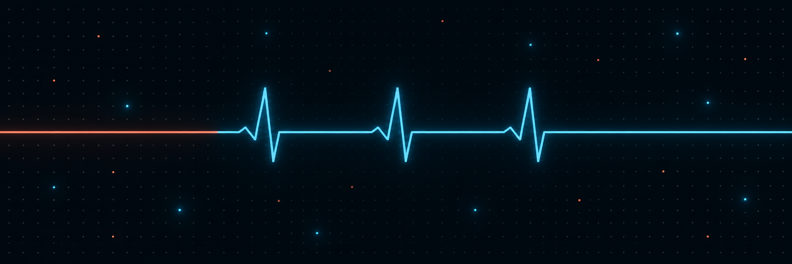
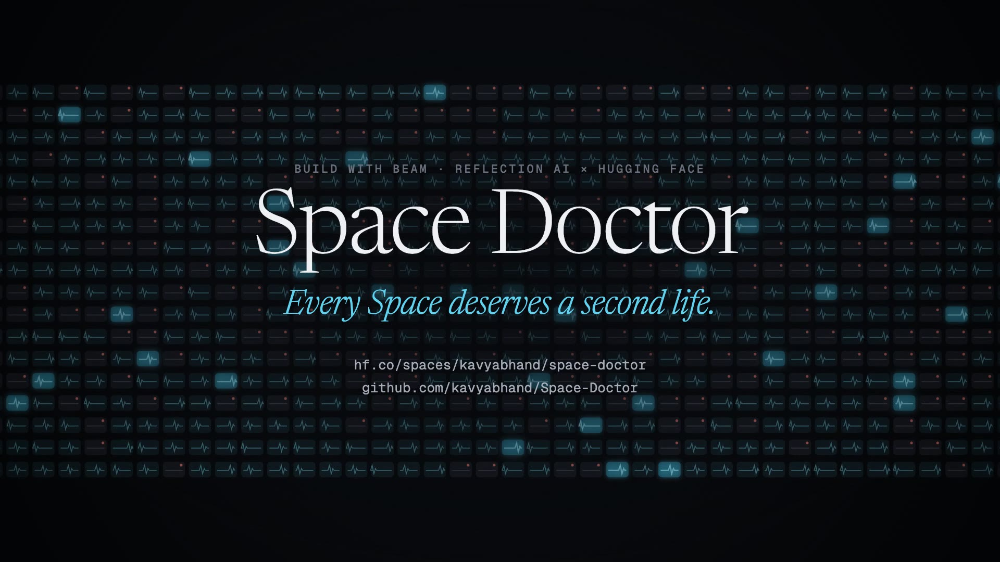

<p align="center">
  
</p>

<h1 align="center">Space Doctor</h1>

<p align="center"><b>Every Space deserves a second life.</b></p>

<p align="center">
  A third of the most-liked Hugging Face Spaces no longer run. Space Doctor gives each one to
  <a href="https://huggingface.co/reflection/Beam-1.0-501B-A23B">Beam</a>, Reflection AI's open 501B model, to diagnose and repair,
  then rebuilds the Space and calls its API. A repair only counts if a real answer comes back.
</p>

<p align="center">
  <i>Made by <a href="https://huggingface.co/kavyabhand">Kavya Bhand</a> &amp; <a href="https://huggingface.co/aadi-joshi">Aadi Joshi</a> for the Build with Beam challenge</i>
</p>

<p align="center">
  <a href="https://huggingface.co/reflection/Beam-1.0-501B-A23B"></a>
  <a href="https://huggingface.co/spaces/kavyabhand/space-doctor"></a>
  <a href="https://huggingface.co/datasets/kavyabhand/spacerot"></a>
  <a href="08_results"></a>
  <a href="08_results#pull-requests"></a>
</p>

---

<p align="center"><a href="https://huggingface.co/spaces/kavyabhand/space-doctor/resolve/main/assets/demo.mp4"></a><br><sub>▶ Watch the 90-second film</sub></p>

## TL;DR

| | |
|---|---|
| **Problem** | Of the 10,000 most-liked Spaces, **3,513 (35%) are broken**, holding **211,237 likes**. Most did nothing wrong: Spaces reinstall unpinned dependencies on every rebuild, and old code meets new libraries. |
| **What we built** | A pipeline where Beam reads a broken Space in full (repo, Hugging Face's log, our rebuild log, installed packages, the build recipe) and writes a repair. Code then rebuilds the Space and calls its main endpoint. Nothing counts on Beam's word. |
| **Result** | **222 broken Spaces treated, 34 revived and verified**, every one reviewed by a person. **24 pull requests** opened on the original Spaces, including Stability AI's, Microsoft's and Meta's. |
| **Against a no-model baseline** | On the 204 patients run both ways, **Beam revived 30, the baseline 9**. |
| **Honesty** | Beam said "unfixable" 71 times instead of faking it. **6 patches passed every automatic check and were still rejected at review** for gaming the verifier. We report all of it. |
| **Beam usage** | 1 long-context triage call over 3,393 error logs (403K tokens, only 9,339 reasoning tokens), then 638 repair calls at a median of 1,374 reasoning tokens each, about 3,090 output tokens per revived Space (49,672 per revival counting every failed Space too). All on Reflection's free daily tier. |

---

## The story, in twelve chapters

Each folder is one chapter: a README that tells that part of the story, and the code that does it.

| | Chapter | What it covers |
|---|---|---|
| 01 | [The problem](01_the_problem) | The census of the 10,000 most-liked Spaces, and why a third of them die |
| 02 | [The idea](02_the_idea) | Space Doctor in one page: what Beam does, what code checks, and the rules we held ourselves to |
| 03 | [Census and triage](03_census_and_triage) | Reading every public error log, and Beam naming the causes in **one call** |
| 04 | [Reproduce](04_reproduce) | Rebuilding each Space the way Spaces does; a Space is only a patient if it still fails |
| 05 | [Repair with Beam](05_repair_with_beam) | **How Beam is used**: the prompt, the tool loop, dated lockfiles, effort escalation, the budget guard |
| 06 | [Verify and review](06_verify_and_review) | Three generations of API probes, the integrity guard, and a human review of every revival |
| 07 | [Baseline](07_baseline) | Does it take a model? A free "time-travel" fix, run on the same patients |
| 08 | [Results](08_results) | 34 revivals, the full outcome table, every pull request |
| 09 | [Honesty](09_honesty) | Where Beam could have cheated, where it tried, and what caught it |
| 10 | [Gallery](10_gallery) | The results page published as a Hugging Face Space |
| 11 | [Tools for owners](11_tools_for_owners) | Fix your own Space with one command; open a PR only for a verified fix |
| 12 | [Run it yourself](12_run_it_yourself) | Machines, commands, costs, and how to reproduce every number |

---

## How Beam is used

| Step | What Beam does | Why it needs Beam |
|---|---|---|
| Triage | Reads the error logs of all 3,393 broken Spaces in **one call** (403,063 input tokens, 70 s) and names root causes as regexes; a second call covers what the first missed | The whole failure landscape at once, in long context |
| Diagnosis | Gets the repo (most relevant files first), HF's log, our rebuild log, `pip freeze` and the Dockerfile; cites the decisive log line | Long-context reasoning across code, logs and package versions |
| Strategy | Chooses per Space: a minimal code edit, a **dated lockfile** (`uv pip compile --exclude-newer <date Beam picks>`), or both | A judgement call, not a rule |
| Tool loop | Asks for files it was not shown (`need_files`); gets patch and lockfile errors back in seconds, before any rebuild | Agentic repair with cheap checks first |
| Escalation | `reasoning_effort` medium → medium → high, only after a failed rebuild | 18 revivals at medium on the first try, 6 needed high |
| Abstention | May answer `"verdict": "unfixable"` | It did, 71 times: owner-only keys, gated models, dead download links |

The full detail is in [chapter 05](05_repair_with_beam).

---

## Quick start

```bash
pip install -r requirements.txt            # plus Docker with buildx
export REFLECTION_API_KEY=...              # free key from platform.reflection.ai
python 11_tools_for_owners/cli.py owner/your-broken-space
```

That reproduces the failure, lets Beam patch it, rebuilds the Space and calls its API, and leaves a verified patch in
`spacedoctor_runs/`. To reproduce the whole study, see [chapter 12](12_run_it_yourself).

---

## Links

- **Gallery:** [huggingface.co/spaces/kavyabhand/space-doctor](https://huggingface.co/spaces/kavyabhand/space-doctor)
- **Dataset (every case file, patch and Beam trace):** [huggingface.co/datasets/kavyabhand/spacerot](https://huggingface.co/datasets/kavyabhand/spacerot)
- **Model:** [reflection/Beam-1.0-501B-A23B](https://huggingface.co/reflection/Beam-1.0-501B-A23B)
- **Challenge:** [Build with Beam](https://huggingface.co/reflection/Beam-1.0-501B-A23B/discussions/5)

<div align="center">

*Every Space deserves a second life.*

**Kavya Bhand & Aadi Joshi** · Apache-2.0

</div>
